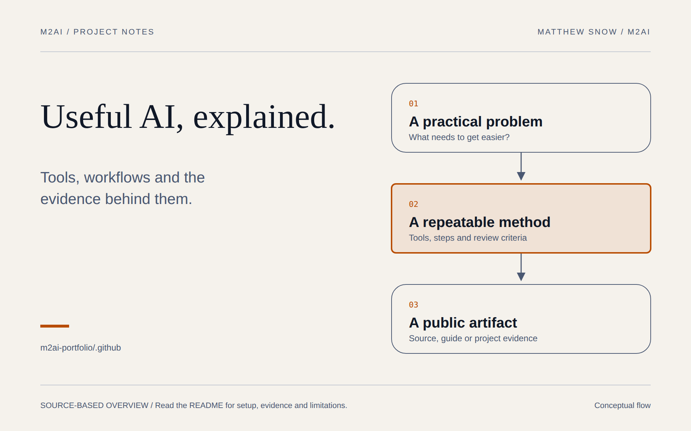

# M2AI Portfolio Profile



A portfolio should help a reader find the useful work and understand what it proves. This repository provides the organization profile for [m2ai-portfolio](https://github.com/m2ai-portfolio): an introduction to Matthew Snow's tools, production methods, teaching resources, and inspectable project evidence.

## What is here

- [profile/README.md](profile/README.md): the organization profile shown by GitHub.
- [profile/assets/](profile/assets/): existing profile and resource artwork.
- [docs/portfolio-hero.png](docs/portfolio-hero.png): the portfolio overview visual.

## Preview and maintain

```bash
git clone https://github.com/m2ai-portfolio/.github.git m2ai-profile
cd m2ai-profile
```

Open `profile/README.md` in a Markdown preview. No application runtime, installation, or credentials are needed to read or edit it.

1. Start with the reader's question: what problem does this project solve?
2. Link each project to its public source or documented evidence.
3. Keep prototypes, historical experiments, guides, and operational claims distinct.
4. Preview the Markdown and inspect images and links before proposing an update.

Publishing profile changes requires a separate GitHub commit/push or pull-request workflow. A local preview does not update the organization page.

Maintained by Matthew Snow / [M2AI](https://memyselfplusai.com). This repository is portfolio configuration, not a standalone application.
