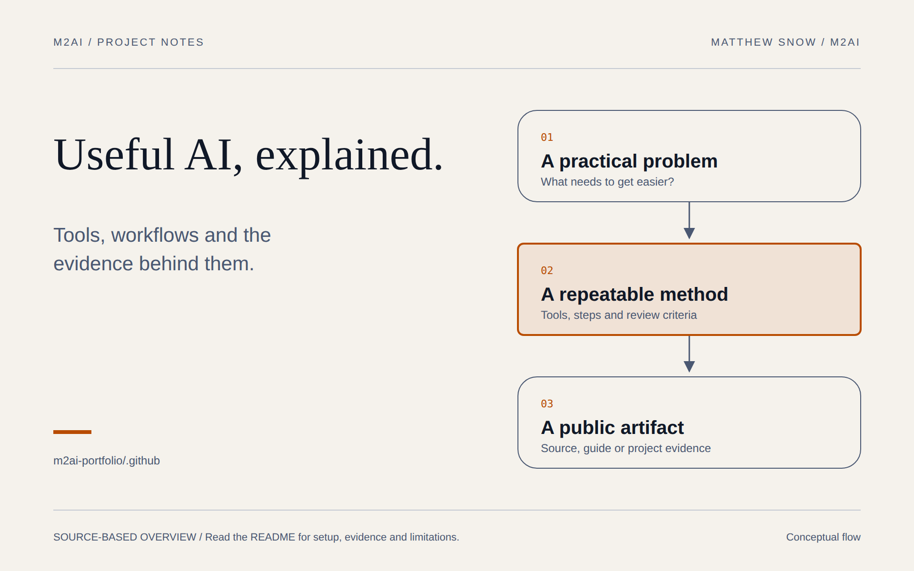

# Matthew Snow / M2AI

I build tools and production methods that make AI useful in a real workflow. That means explaining the problem, defining what a good result looks like, and giving the next person enough source, instructions, and evidence to inspect the work.

This portfolio spans creative production, reusable agent skills, workflow coordination, and practical AI education. Some repositories are applications; others are prototypes, operating procedures, or recorded experiments. Each README explains its current scope and how to explore it.

[Website](https://memyselfplusai.com) · [Personal GitHub](https://github.com/MatthewSnow2) · [LinkedIn](https://linkedin.com/in/matthewsnow2) · [Learning kits](https://snowdrift840.gumroad.com)

## Start with the work

| Project | The problem it addresses | What to inspect |
|---|---|---|
| [HyperFrames Video Workflow](https://github.com/m2ai-portfolio/hyperframes-video-guide) | A rendered video still needs a story, audible narration, readable captions, and deliberate timing. | A production SOP from script and voiceover through scene checks and final review. |
| [M2AI Skills Pack](https://github.com/m2ai-portfolio/m2ai-skills-pack) | Useful operating knowledge disappears between projects and agent sessions. | 185 skill files organized into seven plugins, including creative prompting, evaluation, handoffs, and workflow design. |
| [Engineering Loop](https://github.com/m2ai-portfolio/engineering-loop-showcase) | An AI-assisted rewrite needs evidence that it improved the result. | A recorded four-case comparison, per-assertion judgments, and reusable evaluation prompts. |
| [Prompt Pocket](https://github.com/m2ai-portfolio/quick-prompt-cards) | Useful prompts are difficult to find, adapt, and reuse on a phone. | A React Telegram Mini App with prompt cards, local fallback, and a separately configured sync service. |
| [Matrix](https://github.com/m2ai-portfolio/matrix) | Decisions and lessons become scattered across AI conversation histories. | A conversation warehouse with ingestion, search, and an evaluation approach. |
| [Card Fan-out](https://github.com/m2ai-portfolio/card-fanout) | Parallel agent work needs explicit assignments and acceptance criteria. | A deterministic work-card parser followed by a separate agent workflow. |

## Watch and explore

- [Agent Swarm walkthrough](https://youtu.be/pjZooydbmEc): mapping a code repository with checked findings.
- [HyperFrames guide](https://m2ai-portfolio.github.io/hyperframes-video-guide/): a narrated-video production method.
- [Engineering Loop case study](https://m2ai-portfolio.github.io/engineering-loop-showcase/): compare the outputs and grading behind a skill rebuild.
- [Fable Ladder](https://m2ai-portfolio.github.io/fable-ladder/): progress from a single loop to coordinated agent work.
- [Claude Mods demos](https://m2ai-portfolio.github.io/claude-mods/): session continuity and handoff tooling.

These links lead to different kinds of evidence. A tutorial explains a method; a case study records a bounded experiment; an application repository documents its runtime requirements. None is a substitute for reviewing the actual output.

## Tools, workflows, and SOPs

| Area | Public resources |
|---|---|
| Creative production | [Video SOP](https://github.com/m2ai-portfolio/hyperframes-video-guide/blob/main/hyperframes-video-workflow.md), [content and media skills](https://github.com/m2ai-portfolio/m2ai-skills-pack/tree/master/m2ai-workflow-content) |
| Quality and evaluation | [Engineering Loop](https://github.com/m2ai-portfolio/engineering-loop-showcase), [safety and verification skills](https://github.com/m2ai-portfolio/m2ai-skills-pack/tree/master/m2ai-safety-verification) |
| Delegation and handoff | [Card Fan-out](https://github.com/m2ai-portfolio/card-fanout), [starter templates](https://github.com/m2ai-portfolio/m2ai-starters), [Claude Mods](https://github.com/m2ai-portfolio/claude-mods) |
| Defensive agent design | [Mythos Jr](https://github.com/m2ai-portfolio/mythos-jr), with worker/host boundaries and operator responsibilities |
| Workflow modeling | [WorkflowMCP](https://github.com/m2ai-portfolio/workflowmcp), a local validation and simulation prototype |

## How I approach the work

1. **Start with a bounded problem.** Name the reader or user, the desired outcome, and the constraints.
2. **Make quality observable.** Define what must be present and what would make the result fail.
3. **Build a repeatable method.** Capture useful practices in code, prompts, guides, or templates.
4. **Inspect the result.** Review the artifact and its limits before widening scope or automating more.

The same discipline applies to a video, an agent tool, and a team workshop: the method should make the next attempt easier to reproduce and evaluate.

## Learn and use the projects

Start with a repository's README, follow its smallest local walkthrough, and check its status and prerequisites before connecting accounts or running paid services. Guides and static showcases can be read without those integrations.

- [Practical AI learning and workshops](https://memyselfplusai.com)
- [How to Train Your Agent](https://memyselfplusai.com/edge)
- [AWS walkthrough series](https://memyselfplusai.com/aws)
- [Browse all active repositories](https://github.com/orgs/m2ai-portfolio/repositories?q=archived%3Afalse&sort=updated)

Built and taught in the open by [Matthew Snow](https://github.com/MatthewSnow2), founder of M2AI.
