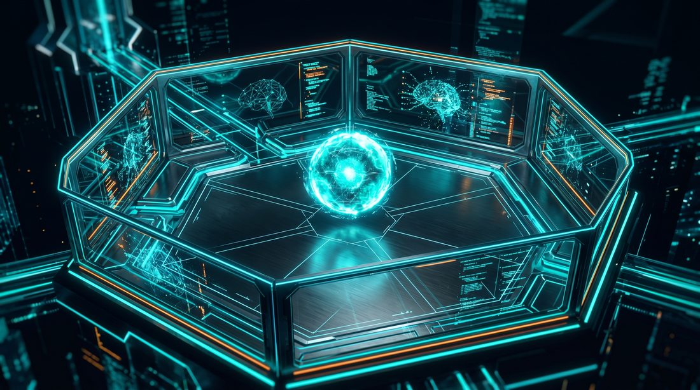

# M2AI

### Building on the edge of AI

**me² + AI.** Production AI agent systems, Model Context Protocol tooling, and multi-agent orchestration, built and shipped in the open by [Matthew Snow](https://github.com/MatthewSnow2).

This is the front door. Start here instead of scrolling the repo list.

---

<table>
<tr>
<td width="50%" valign="top">

### 👋 If you're hiring

A hands-on AI engineer and systems architect who ships: ST Metro, a Level 5 autonomous build pipeline; CMD, a live multi-agent command center; a second-brain memory layer; and ChartingHero, voice-AI in a regulated (HIPAA) domain. Builder-first IC who tracks the frontier and turns papers into working prototypes.

→ Jump to [**what I build**](#on-the-edge-what-i-build) · [**live demos**](#live-demos) · [memyselfplusai.com](https://memyselfplusai.com)

</td>
<td width="50%" valign="top">

### 🤝 If you're a founder

We become your AI team. We translate the internal discipline behind these systems (cost ledgers, watchdogs, staged release, portability) into plain-English wins for non-technical owners who want to delegate real work to agents and trust it.

→ Read [**How to Train Your Agent**](#-how-to-train-your-agent) · watch the [**AWS How-To Series**](https://memyselfplusai.com/aws) · grab the [**prompt goodies**](#prompt-goodies) · [book a call](https://memyselfplusai.com)

</td>
</tr>
</table>

---

## On the edge: what I build

Proof of work, not promises.

| Built | What it is | Signal |
|-------|-----------|--------|
| **ST Metro** | A Level 5 autonomous software-production pipeline: a multi-agent ecosystem that carries an idea through to a shipped product. | [Interactive ecosystem visual](https://m2ai-st-metro.github.io/st-metro-visual/) with zone drill-down. |
| **CMD (Command Center)** | The control plane that dispatches real agents to missions and reviews their output through a judge / reasoner loop. | Production multi-agent orchestration, not a demo. |
| **Second Brain** | A hub-and-spoke knowledge warehouse and shared memory layer. Agents capture signals, recall decisions, and compound what they learn across runs. | Agents that remember and improve. |
| **ChartingHero** | Voice-AI clinical documentation: speech-to-text + Claude API + EMR tool-calling. | ~70% less documentation time in early deployment, HIPAA-compliant. |

---

## Live demos

Things you can click right now.

| Demo | Live | What it shows |
|------|------|---------------|
| **ST Metro Visual** | [m2ai-st-metro.github.io/st-metro-visual](https://m2ai-st-metro.github.io/st-metro-visual/) | The full ecosystem, interactive with zone drill-down. |
| **On the Edge** | [memyselfplusai.com/edge](https://memyselfplusai.com/edge) | The story + series hub. Each card opens a chapter. |
| **AWS How-To Series** | [memyselfplusai.com/aws](https://memyselfplusai.com/aws) | 12 video walkthroughs: a fresh AWS account → calling Claude on Bedrock. |
| **Fable Ladder** | [m2ai-portfolio.github.io/fable-ladder](https://m2ai-portfolio.github.io/fable-ladder/) | Interactive walkthrough. |
| **Engineering Loop** | [m2ai-portfolio.github.io/engineering-loop-showcase](https://m2ai-portfolio.github.io/engineering-loop-showcase/) | The compounding-engineering loop, visualized. |

---

## Skill & agent packs

Curated bundles you can install in one step.

| Pack | For | What it is |
|------|-----|-----------|
| [m2ai-skills-pack](https://github.com/m2ai-portfolio/m2ai-skills-pack) | Claude Code | Portable Claude Code skills and plugins. 100+ skills in one marketplace. |
| [claude-desktop-skills](https://github.com/m2ai-portfolio/claude-desktop-skills) | Claude Desktop | 21 production-ready Claude Desktop skills plus a Marketing Agents plugin. |
| [m2ai-starters](https://github.com/m2ai-portfolio/m2ai-starters) | Any project | Starter templates. Pull one with `npx degit m2ai-portfolio/m2ai-starters/<name> ./project`. |
| [card-fanout](https://github.com/m2ai-portfolio/card-fanout) | Claude Code | Turn a markdown work card into a parallel agent fan-out: deterministic parsing and guard checks outside, cheap workers and acceptance verdicts inside. |

---

## Featured projects

<table>
<tr>
<td width="25%"></td>
<td width="25%"></td>
<td width="25%"></td>
<td width="25%"></td>
</tr>
<tr>
<td valign="top"><b><a href="https://github.com/m2ai-portfolio/agenttrace">agenttrace</a></b> Logs the reasoning behind code changes and adds spaced repetition so the intent behind a change is not lost.</td>
<td valign="top"><b><a href="https://github.com/m2ai-portfolio/claudeflow">claudeflow</a></b> Unified AI coding assistant with fallback models and fast research.</td>
<td valign="top"><b><a href="https://github.com/m2ai-portfolio/taskflow-mcp-server">taskflow-mcp-server</a></b> Durable task management MCP server for long-running agentic workflows.</td>
<td valign="top"><b><a href="https://github.com/m2ai-portfolio/mythos-jr">mythos-jr</a></b> Non-initiating defensive cybersecurity worker agent (Claude Agent SDK + A2A).</td>
</tr>
</table>

---

## 🐉 How to Train Your Agent

A 4-part, no-code series for anyone who keeps meaning to "use AI more." You do not program an agent. You **train** one, the way you train a sharp new hire: show it your judgment, give it a job with edges, prove it before you trust it, then build a team.

<table>
<tr>
<td width="25%"></td>
<td width="25%"></td>
<td width="25%"></td>
<td width="25%"></td>
</tr>
<tr>
<td valign="top"><b>1. You're Already Doing the Training</b> Your everyday "keep this, skip that" calls ARE the training data.</td>
<td valign="top"><b>2. Give It a Job With Edges</b> Turn a fuzzy wish into a job an agent can actually run.</td>
<td valign="top"><b>3. Prove It Before You Trust It</b> Trust is built, not given.</td>
<td valign="top"><b>4. Build a Team, Not a Cuttlefish</b> One agent, one job; grow into a roster.</td>
</tr>
</table>

▶ **Read the series:** [memyselfplusai.com/edge](https://memyselfplusai.com/edge) · 🎬 **Video walkthroughs: coming soon.**

---

## ☁️ AWS How-To Series

Brand new to the cloud? A plain-English, click-by-click path from a fresh AWS account to running Claude on Amazon Bedrock. Twelve short screen-recorded walkthroughs, no jargon, nothing skipped.

- **Foundations (start here):** Console Tour · Lock down root + create an admin (MFA & IAM) · Billing budget & cost alerts · Your first S3 bucket · VPC basics · Launch & connect an EC2 server · Set up the AWS CLI · Store a secret in Secrets Manager
- **Bedrock setup guides:** A tour of Amazon Bedrock · Grant programmatic access (the exact IAM policy) · Create an access key
- **Bonus:** Call Claude from a Lambda function

▶ **Watch the series:** [memyselfplusai.com/aws](https://memyselfplusai.com/aws)

---

## Prompt goodies

An escalating ladder of copy-paste delegation-prompt patterns, extracted from prompts a frontier model wrote for *itself* while orchestrating subagents. Each rung is a paste-ready asset, not a lecture. Rungs 1-5 work on any task you hand an AI; 6-8 are for when multiple agents share a workspace.

1. **Show me the receipt:** demand the exact command + output, not a claim of "done."
2. **Stay in your lane:** say what NOT to touch, and who owns it.
3. **Iterate until green:** give the verify command; passing it *is* the definition of done.
4. **Warn them about your house:** relay your environment's quirks, with the workaround.
5. **Name the slop:** quote the bad output you don't want, instead of asking for "high quality."
6. **Pin the contract:** paste the shared interface verbatim into every worker's prompt.
7. **Least privilege you can grep:** the permission list must be greppable against actual use, both directions.
8. **The never list:** define each agent by what it refuses to do, pointing at the neighbor who owns it.

▶ **Get the copy-paste blocks:** [memyselfplusai.com/edge#prompt-goodies](https://memyselfplusai.com/edge#prompt-goodies)

---

## 🎓 Work with me

Want to build your own agents? Join the **Early AI-Dopters** community on Skool. Every subscription includes a 1:1, agent-specific coaching call: we set up your first trained agent together, start to finish.

▶ **[Join Early AI-Dopters → get your coaching call](https://www.skool.com/earlyaidopters/about?ref=9a7b59dfbd814636a81171ef857082bc)**

---

## Browse everything

Filter the full org instead of scrolling:

- Showcase products: [`topic:showcase`](https://github.com/orgs/m2ai-portfolio/repositories?q=topic%3Ashowcase)
- All active repos: [m2ai-portfolio repositories](https://github.com/orgs/m2ai-portfolio/repositories?q=archived%3Afalse)

## Contact

Matthew Snow · [memyselfplusai.com](https://memyselfplusai.com) · [LinkedIn](https://linkedin.com/in/matthewsnow2) · [@MatthewSnow2](https://github.com/MatthewSnow2)
